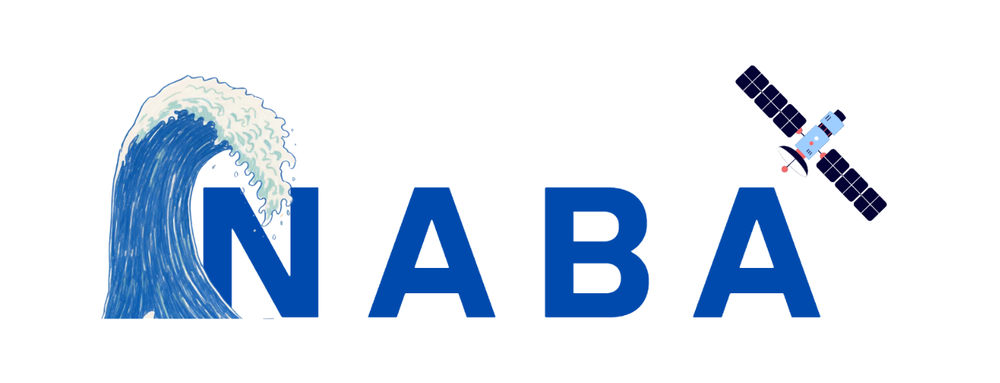

<p align="center">
  
</p>

<h3 align="center">Earth's news, before it breaks.</h3>

<p align="center">
  <a href="https://ahmedashry7.github.io/naba/"><b>Open the live site → ahmedashry7.github.io/naba</b></a>
</p>

---

**Naba** (نبأ, Arabic for *news*) is a newsroom for the Earth. It turns measurements from
[NISAR](https://nisar.jpl.nasa.gov/), the NASA–ISRO L-band radar satellite, into short news stories on an
interactive 3D globe. Each story has a headline, a place, one measured number, a chart over time, possible
causes, why it matters, what to check next and an honest confidence level.

Radar sees through cloud and smoke, day and night, but its images are hard for most people to read. Naba does the
reading: a Python pipeline streams only the part of each NISAR product that covers a site, measures the change and
writes it up as a plain-language story.

Built by **Team Naba** for the **NASA Space Apps Challenge 2026**, challenge *Dancing with the SARs*.

## What's on the globe

Seven stories, all measured from real NISAR data (June – October 2026):

| Story | NISAR product | What the radar measured |
|---|---|---|
| M7.7 earthquake, Azuero peninsula, Panama | GUNW interferogram, 2 → 14 Oct | Up to 1.16 m of ground motion along the satellite's line of sight |
| Plaskett Fire, Big Sur, California | GCOV, 6 passes | 31 km² likely burned + 15 km² possibly burned |
| Everglades drought fires, Florida | GCOV, 6 passes | 19 km² likely burned + 30 km² possibly burned |
| Okavango Delta, Botswana | GCOV, 9 passes | Open water fell from 48.0 % to 14.3 % of the area |
| Everglades, Florida (open water) | GCOV, 10 passes | Open water rose from 4.2 % to 12.5 % |
| Everglades, Florida (flooded vegetation) | GCOV, 10 passes | Flooded vegetation rose from 4.4 % to 8.4 % |
| Lake Manzala, Nile Delta, Egypt | GCOV, 9 passes | Flooded vegetation rose from 2.4 % to 2.6 % |

**Try it:** open the [live site](https://ahmedashry7.github.io/naba/), watch the short intro, take the guided tour,
then click the red pin in California and drag the slider to watch the burn scar appear pass by pass.
**Compare dates** puts the radar images from two dates side by side.
[`?story=plaskett-burn-scar`](https://ahmedashry7.github.io/naba/?story=plaskett-burn-scar) opens a story directly.

## How it works

```
NASA CMR (search, metadata only)        NISAR HDF5 products on NASA Earthdata (4–6 GB each)
              │                                       │  HTTPS range reads: only the site's chunks
              ▼                                       ▼
   naba-data/  (Python)  search → stream HH/HV → measure → polygons + image frames → stories
              │  writes
              ▼
   frontend/public/data/  (GeoJSON + JSON + PNG/WebP frames, with full provenance)
              │  fetch
              ▼
   frontend/  (React + MapLibre globe)          quest/  (Unity app for Meta Quest 3S)
```

- **Wetlands (GCOV):** each pixel is classed from its HH and HV backscatter in dB: *open water* is dark in both,
  *flooded vegetation* has bright HH and a large HH−HV gap. Passes are composited per month.
- **Fires (GCOV):** the HV signal of every pass is compared with the last pass before the fire. A drop of more than
  3 dB is *likely burned*, 2–3 dB is *possibly burned*.
- **Earthquakes (GUNW):** unwrapped phase is converted to metres of line-of-sight motion (phase × 0.242 m ÷ 4π),
  keeping pixels with coherence ≥ 0.3.
- **Stories** are filled from templates with the measured numbers. No language model writes them.
- **Provenance:** every granule, threshold, date and megabyte read is recorded in
  `frontend/public/data/provenance*.json`.
- **Small reads:** for the two fires, Naba read about 252 MB out of about 61 GB of products (0.4 %).

The thresholds are exploratory, not validated flood or burn-severity maps, and NISAR data is still PROVISIONAL.
Every story states its confidence and limits, and the fire stories show the officially reported fire size next to
the radar's number.

## Repository layout

| Path | What it is |
|---|---|
| `frontend/` | The website: React 18, TypeScript, Vite, Tailwind CSS, MapLibre GL JS 5, Zustand |
| `frontend/public/data/` | The dataset the website reads, written by `naba-data` |
| `naba-data/` | The Python pipeline: NISAR in, the website's dataset out, with tests |
| `quest/` | Mixed-reality version for Meta Quest 3S (Unity 6) and its asset pipeline |
| `.github/workflows/deploy-pages.yml` | Builds and publishes the website to GitHub Pages |
| `PROJECT.md` | Detailed architecture, data formats and method notes |
| `NISAR_demo_sites.md` | Candidate sites and granules, checked against ASF |

## Setup

### Website

Needs Node.js 18 or newer. No backend, accounts or API keys: the dataset is already in the repo.

```bash
cd frontend
npm install
npm run dev        # http://localhost:5173
npm run build      # type-check + production build into dist/
```

Useful URLs: `/?demo=1` autoplays the main path (press **D** to restart), `/?story=<id>` opens a story.

### Data pipeline (optional, to re-measure or add sites)

Needs Python 3.10+ and a free [NASA Earthdata Login](https://urs.earthdata.nasa.gov). Searching works without
a login; streaming pixels needs one.

```bash
cd naba-data
python -m venv ~/.venvs/naba && . ~/.venvs/naba/bin/activate
pip install -r requirements-export.txt
cp .env.example .env            # fill in EARTHDATA_USERNAME and EARTHDATA_PASSWORD

python -m naba_data search   --preset manzala    # what NISAR data exists (metadata only)
python -m naba_data estimate --preset manzala    # how many MB one read would move
python -m naba_data export   --preset manzala    # measure and write into frontend/public/data
python -m naba_data quake-export --preset panama # the earthquake interferogram
pytest                                           # 51 tests
```

Presets: `manzala`, `okavango`, `everglades-wetlands` (wetlands), `plaskett`, `everglades` (fires) and `panama`
(earthquake). Each export replaces only its own preset's part of the dataset, so they can run in any order.
Subsets are cached as GeoTIFFs, so a re-run downloads nothing (`--offline` forces this).
New sites go in `naba_data/config.py`.

> On WSL, keep the virtualenv on the Linux filesystem (for example `~/.venvs`), not under `/mnt/c` or `/mnt/d`.
> Installing there can be 10–50× slower.

### Meta Quest 3S app (optional)

Open `quest/unity` in Unity Hub with editor **6000.4.0f1**, open `Assets/Scenes/SampleScene` and press Play
(the mouse works without a headset). To build for the headset: **File → Build Profiles → Android**, run Meta's
**Project Setup Tool → Fix All**, connect the Quest in developer mode and **Build And Run**.
When the website's data changes, run `python make_story_data.py` in `quest/pipeline`. See
[`quest/README.md`](quest/README.md).

## Deployment

The website is deployed to GitHub Pages at **https://ahmedashry7.github.io/naba/**. Every push to `main` runs
`.github/workflows/deploy-pages.yml`, which builds `frontend/` with `--base=/naba/` and publishes `frontend/dist`.
To redeploy without a code change: **Actions → Deploy to GitHub Pages → Run workflow**.

Paths to files in `frontend/public/` must go through the `asset()` helper in `frontend/src/lib.ts`, so they work
both locally and under `/naba/`.

## Data and credits

- **Radar data:** NASA–ISRO NISAR L2 GCOV and GUNW (PROVISIONAL), found through
  [NASA CMR](https://cmr.earthdata.nasa.gov) and read from NASA Earthdata / ASF DAAC with
  [earthaccess](https://github.com/nsidc/earthaccess).
- **Event facts:** USGS (Panama earthquake); reported fire sizes from Big Sur Kate and WLRN, cited in each story.
- **Maps:** basemap © [CARTO](https://carto.com/attributions), © [OpenStreetMap](https://www.openstreetmap.org/copyright)
  contributors; rendering by [MapLibre GL JS](https://maplibre.org/); Quest globe from Natural Earth.
- **Narration:** the intro and tour voices are AI-generated with Microsoft neural text-to-speech (edge-tts).

Naba is not affiliated with or endorsed by NASA or ISRO and uses no agency logos or mission patches.

## Team

Team Naba: Abdullah Haytham Mohamed Salah, Ahmed Ashry, Basma Mohamed and Nada Abdallah.
